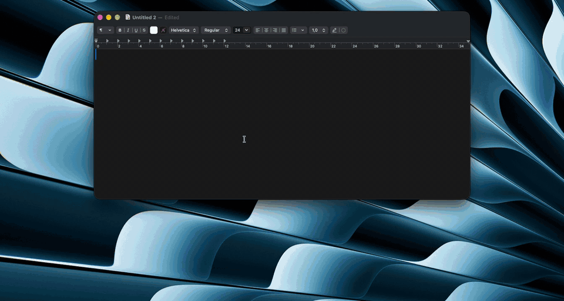

# 9clipboard

[English](README.md) · **Tiếng Việt**

[](https://github.com/lamht09/9clipboard/releases) [](https://github.com/lamht09/9clipboard/releases)    [](LICENSE)

Phần mềm **quản lý clipboard cho Mac** miễn phí, mã nguồn mở: lưu **lịch sử copy/paste** (text, rich text, ảnh) ngay trên máy, không cần mạng — giải pháp nhẹ thay cho Paste và Maccy, viết native bằng Swift/SwiftUI cho macOS (Apple Silicon), hỗ trợ tìm kiếm tiếng Việt không dấu. Bấm **⌥V** để mở dải thẻ ở đáy màn hình, chọn một thẻ là dán luôn vào app đang dùng.



▶ [Xem video demo đầy đủ (49 giây)](assets/demo.mp4)

- Lưu text, rich text và ảnh; tìm fuzzy không dấu tiếng Việt (`da nang` → “Đà Nẵng”)
- Ghim vào các Pinboard, mục đã ghim không bị xoá
- Mật khẩu (từ 1Password, Passwords…) tự xoá sau 15 phút; loại trừ app, tạm dừng ghi
- Giao diện tiếng Anh và tiếng Việt (theo ngôn ngữ của máy, đổi trong Cài đặt › Chung)
- Dữ liệu chỉ nằm trên máy, không có network

## Yêu cầu

- macOS 14 trở lên, Apple Silicon (mọi máy Apple Silicon, kể cả M1, đều cập nhật được lên macOS 14)
- Để build từ mã nguồn: Swift 6 (Command Line Tools là đủ, không cần Xcode): `xcode-select --install`

## Cài bản phát hành

### Cài nhanh (khuyên dùng)

Dán lệnh này vào Terminal:

```sh
curl -fsSL https://raw.githubusercontent.com/lamht09/9clipboard/main/install.sh | bash
```

Lệnh này tải bản mới nhất, kiểm tra app được ký bằng chứng chỉ release của 9clipboard, cài vào `/Applications` rồi mở app. File tải bằng `curl` không bị macOS gắn cờ nên **không có hộp thoại Gatekeeper**. Chạy lại đúng lệnh này để cập nhật. Sau đó cấp quyền Trợ năng khi được hỏi (để dán bằng ⌘V).

### Cài thủ công

1. Tải `9clipboard-<phiên bản>.zip` ở trang [Releases](https://github.com/lamht09/9clipboard/releases), giải nén và chuyển `9clipboard.app` vào `/Applications`.
2. Mở app. App ký bằng chứng chỉ tự ký, không được Apple công chứng (notarize), nên macOS chặn lần mở đầu của **mỗi bản mới**: vào System Settings › Quyền riêng tư & Bảo mật › **Vẫn mở** (Open Anyway). Hoặc bỏ qua bước này bằng cách xoá cờ tải về trước khi mở:
   ```sh
   xattr -dr com.apple.quarantine /Applications/9clipboard.app
   ```
3. Cấp quyền Trợ năng khi được hỏi (để dán bằng ⌘V). Mọi bản phát hành ký cùng một chứng chỉ nên cập nhật bằng cách thay app vẫn giữ quyền này.

## Build và cài

```sh
make cert      # chỉ chạy một lần: tạo chứng chỉ tự ký "9clipboard Dev" trong Keychain
make install   # build release, ký, copy vào /Applications/9clipboard-dev.app và mở app
```

Các lệnh khác:

| Lệnh | Việc |
|---|---|
| `make run` | Build, ký và chạy từ `build/9clipboard-dev.app` |
| `make test` | Chạy unit test của `ClipCore` (đừng dùng `swift test` trần: chỉ có Command Line Tools thì thỉnh thoảng không nạp được plugin `TestingMacros`) |
| `make bench` | Đo tìm kiếm 2000 mục ở bản release (mục tiêu < 10ms) |
| `scripts/make-icon.sh` | Vẽ lại `Resources/AppIcon.icns` |

**Vì sao cần chứng chỉ tự ký:** macOS nhớ quyền Trợ năng theo chữ ký của app. Ký ad-hoc thì mỗi lần build là một chữ ký mới và quyền bị mất; ký bằng cùng một chứng chỉ thì quyền được giữ.

**Bản build trên máy là một app riêng:** `make run` / `make install` tạo **9clipboard Dev** (bundle ID `io.github.lamht09.9clipboard.dev`, dữ liệu ở `~/Library/Application Support/9clipboard-dev/`), nên không tranh quyền Trợ năng hay lịch sử với bản release đã cài.

**Bản phát hành** do GitHub Actions build và ký khi push tag `v*`, job ký chờ duyệt tay trong environment `release`. Thiết lập một lần: `make release-cert` tạo chứng chỉ và lưu thành secret của environment (xem `.github/workflows/release.yml`).

## Cấp quyền

Lần đầu chạy, app xin quyền **Trợ năng (Accessibility)** để gửi phím ⌘V vào app đang dùng:

System Settings › Quyền riêng tư & Bảo mật › Trợ năng › bật **9clipboard** (hoặc **9clipboard Dev** với bản build trên máy).

Không cấp cũng dùng được: chọn thẻ thì nội dung được copy, bạn tự bấm ⌘V, hoặc kéo thẻ thả thẳng vào app kia. Trạng thái quyền xem ở Cài đặt › Quyền.

## Phím tắt trong panel

| Phím | Việc |
|---|---|
| gõ chữ | Tìm kiếm |
| `←` `→` | Chọn thẻ |
| `Enter` / click | Dán |
| `⇧Enter` | Dán dạng text thuần |
| `⌘1`…`⌘9` | Dán nhanh thẻ thứ 1–9 |
| kéo thẻ ra khỏi panel | Thả nội dung đúng chỗ nhả chuột (ô nhập, Notes, Finder…); không cần quyền Trợ năng |
| `Space` | Xem trước cỡ lớn (khi ô tìm trống) |
| `Tab` / `⇧Tab` | Đổi tab lọc |
| `⌘P` | Ghim vào Pinboard |
| `⌘⌫` | Xoá thẻ |
| `Esc` | Đóng xem trước → xoá ô tìm → đóng panel |

Đổi phím tắt mở panel, giới hạn lịch sử, chạy khi đăng nhập… ở menu bar › **Cài đặt…** (⌘,).

## Dữ liệu

`~/Library/Application Support/9clipboard/` (quyền 0700): `clips.sqlite`, ảnh gốc trong `blobs/`, thumbnail trong `thumbs/`. Xoá thư mục này là xoá sạch lịch sử.

Nếu sửa DB bằng `sqlite3`, luôn chạy `pragma foreign_keys=on;` trước, nếu không sẽ sót dòng mồ côi và app không khởi động được.

## Giấy phép

[MIT](LICENSE)
