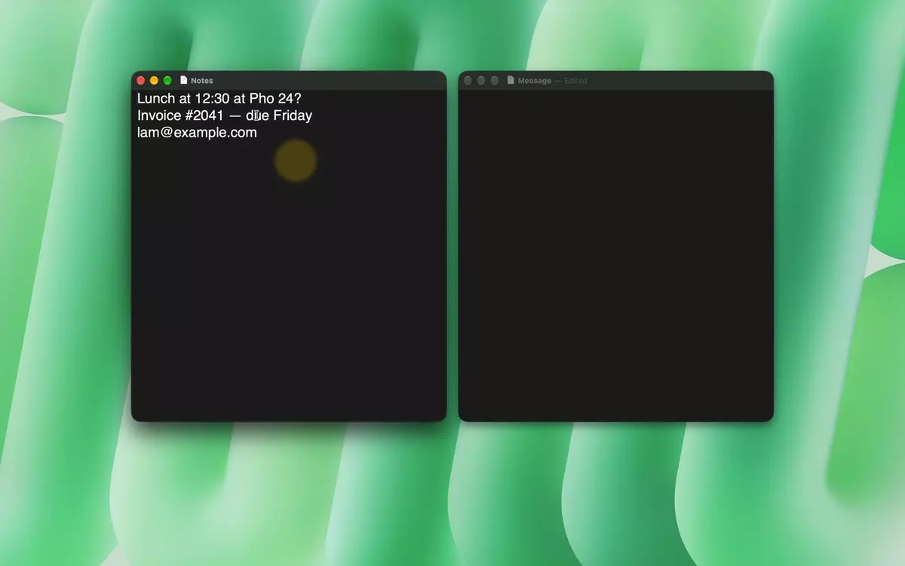

# 9clipboard

[English](../README.md) · **Tiếng Việt** · [简体中文](README.zh-Hans.md) · [繁體中文](README.zh-Hant.md) · [日本語](README.ja.md) · [한국어](README.ko.md) · [Español](README.es.md) · [Français](README.fr.md) · [Deutsch](README.de.md) · [Português](README.pt-BR.md) · [Русский](README.ru.md) · [Italiano](README.it.md)

[](https://github.com/lamht09/9clipboard/releases) [](https://github.com/lamht09/9clipboard/releases)  [](../LICENSE)

**Lịch sử clipboard cho Mac.** Cứ copy như bình thường, rồi bấm **⌥V** (Option‑V) để lấy lại bất cứ thứ gì đã copy trước đó — text, text có định dạng hay ảnh — và dán thẳng vào app đang dùng.

Miễn phí, mã nguồn mở và riêng tư: lịch sử chỉ nằm trên máy bạn. Một lựa chọn gọn nhẹ thay cho Paste và Maccy.



▶ [Xem video demo đầy đủ (64 giây)](../assets/demo.mp4)

## Cài đặt

Cần máy Mac chip Apple Silicon (M1 trở lên) chạy macOS 14 Sonoma trở lên.

Mở **Terminal** (bấm ⌘Space, gõ “Terminal”, Enter), dán dòng này rồi bấm Enter:

```sh
curl -fsSL https://raw.githubusercontent.com/lamht09/9clipboard/main/install.sh | bash
```

Lệnh này tải bản mới nhất, kiểm tra đúng là app thật, cài vào Applications rồi mở app.

<details>
<summary>Muốn tự tải về?</summary>

1. Tải `9clipboard-<phiên bản>.zip` ở trang [Releases](https://github.com/lamht09/9clipboard/releases), giải nén và kéo `9clipboard.app` vào Applications.
2. Mở app. macOS sẽ báo không kiểm tra được app, vì 9clipboard không đăng ký với Apple. Vào **System Settings › Quyền riêng tư & Bảo mật** và bấm **Vẫn mở** (Open Anyway). Mỗi bản mới tải theo cách này sẽ hỏi lại một lần.

</details>

## Bắt đầu

1. Copy vài thứ như bình thường.
2. Bấm **⌥V**. Lịch sử hiện thành một dải thẻ ở đáy màn hình.
3. Click một thẻ (hoặc bấm Enter) là nội dung được dán vào app bạn đang dùng.

Lần đầu, macOS sẽ hỏi cho phép **Trợ năng** (Accessibility) cho 9clipboard. Quyền này để app bấm ⌘V giúp bạn. Bật trong **System Settings › Quyền riêng tư & Bảo mật › Trợ năng**. Không muốn cấp cũng không sao: click thẻ thì nội dung được copy và bạn tự bấm ⌘V, hoặc kéo thẻ thả vào app kia.

## Làm được gì

- **Tìm nhanh.** Cứ gõ là tìm. Không cần dấu, không cần gõ đủ chữ: `da nang` ra “Đà Nẵng”.
- **Tìm tiếng Trung, Nhật, Hàn theo cách đọc.** Gõ pinyin, romaji hoặc phụ âm đầu: `beijing` ra “北京”, `tokyo` ra “東京タワー”, `ㅎㄱ` ra “한국”.
- **Dán không định dạng** khi bấm ⇧Enter.
- **Kéo thả.** Kéo thẻ vào tài liệu, ô chat, Notes hay Finder.
- **Giữ thứ hay dùng.** Ghim thẻ vào Pinboard; thẻ đã ghim không bao giờ bị xoá.
- **Tự dọn mật khẩu.** Mật khẩu copy từ 1Password, Passwords… tự xoá sau 15 phút nếu bạn không giữ lại.
- **Không làm phiền.** Loại trừ những app không muốn ghi lại, hoặc tạm dừng ghi từ menu bar.
- **Nói ngôn ngữ của bạn.** English, Tiếng Việt, 简体中文, 繁體中文, 日本語, 한국어, Español, Français, Deutsch, Português, Русский, Italiano.
- **Tự cập nhật** trong Cài đặt › Cập nhật.

## Phím tắt

Trong panel:

| Phím | Việc |
|---|---|
| Gõ chữ | Tìm kiếm |
| `←` `→` | Chuyển thẻ |
| `Enter` hoặc click | Dán |
| `⇧Enter` | Dán dạng text thuần |
| `⌘1` … `⌘9` | Dán thẻ thứ 1–9 |
| `Space` | Xem trước cỡ lớn |
| `Tab` | Tab lọc tiếp theo (Tất cả, Text, Ảnh…) |
| `⌘P` | Ghim |
| `⌘⌫` | Xoá |
| `Esc` | Đóng |

Muốn đổi ⌥V hay các tuỳ chọn khác, click biểu tượng 9clipboard trên menu bar và chọn **Cài đặt…**.

## Quyền riêng tư

- Lịch sử chỉ lưu trên máy bạn.
- Lần duy nhất 9clipboard lên mạng là hỏi GitHub số phiên bản mới nhất. Không gửi gì về bạn hay clipboard, và tắt được trong Cài đặt › Cập nhật.
- Quyền Trợ năng chỉ dùng để bấm ⌘V giúp bạn.

## Câu hỏi thường gặp

**Click thẻ mà không dán.**
Xem Cài đặt › Quyền. Nếu chưa có quyền Trợ năng, bật 9clipboard trong System Settings › Quyền riêng tư & Bảo mật › Trợ năng.

**Cập nhật thế nào?**
Cài đặt › Cập nhật, hoặc chạy lại lệnh cài. Lịch sử và cài đặt vẫn được giữ nguyên.

**Gỡ cài đặt thế nào?**
Thoát 9clipboard từ biểu tượng trên menu bar rồi kéo app từ Applications vào Thùng rác. Muốn xoá luôn lịch sử thì xoá thư mục `~/Library/Application Support/9clipboard`.

## Dành cho lập trình viên

Build từ mã nguồn, chạy test và phát hành: xem [CONTRIBUTING.md](../CONTRIBUTING.md) (tiếng Anh).

## Giấy phép

[MIT](../LICENSE)
